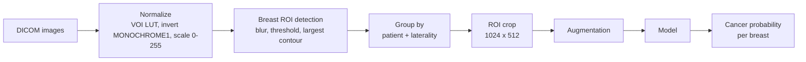
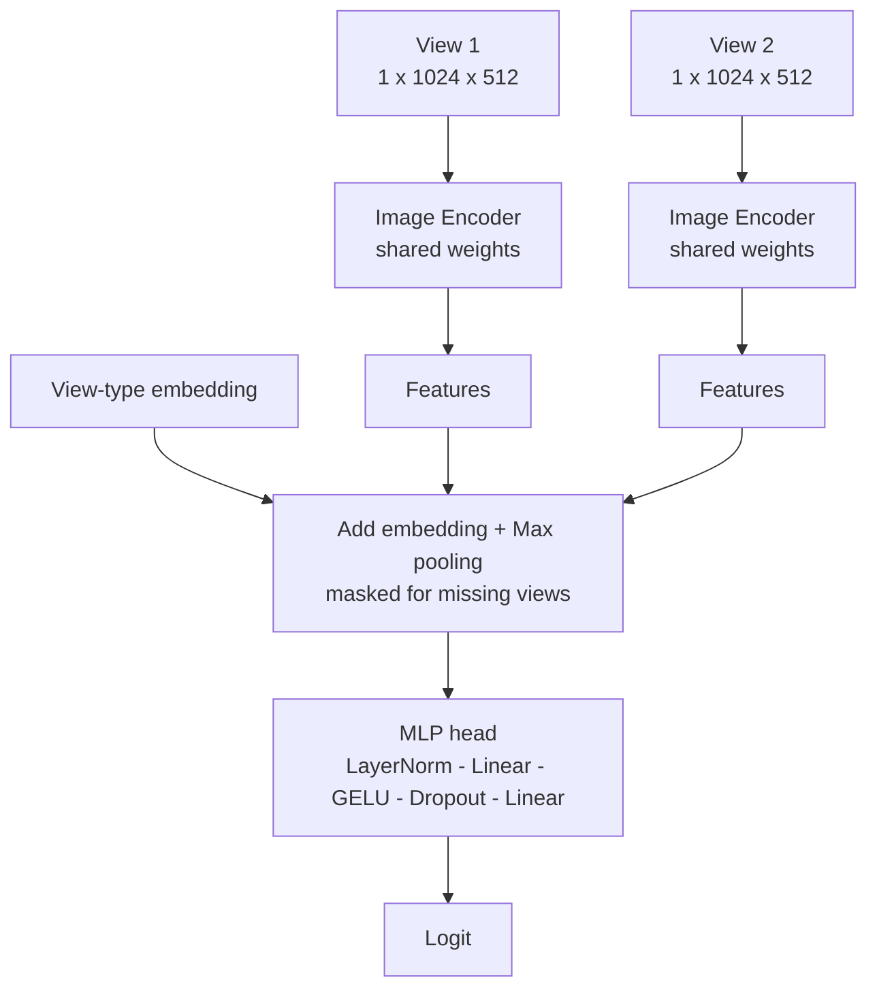

# Mammo: Multi-View Breast Cancer Detection

Deep learning pipeline for breast cancer detection from screening mammograms, built for the [RSNA Screening Mammography Breast Cancer Detection](https://www.kaggle.com/competitions/rsna-breast-cancer-detection) challenge.

The model looks at **all available views of one breast** (e.g. CC and MLO) and predicts one cancer score per patient and side.

---

## Highlights

- **Breast ROI cropping**: removes background and markers, so the model sees more tissue detail.
- **Multi-view input**: up to 2 views per breast, combined with a view-type embedding and max pooling.
- **Imbalance handling**: patient-level negative downsampling each epoch, `pos_weight` loss, and logit adjustment back to real prevalence.
- **Memory-friendly training**: mixed precision (fp16), gradient accumulation, and gradient checkpointing.
- **Metrics**: probabilistic F1 / F2 and best-threshold search.
- **Models** : EfficientNetV2-RW-M and Convnext_small
- **Image Size (before and after Pr Resizing)** : 1024*512 and 2048*1024

---

## Pipeline



## Model



## Training Configuration

| Category | Setting | Value |
|---|---|---|
| **Data** | Input size | 1024 × 512 → 2048 × 1024 ROI crop, 1 channel |
| | Views per breast | 2 (missing view is copied from the real one, and masked) |
| | ROI padding | 10 px |
| | Crop in training / validation | Random / center |
| | Validation split | 1 fold of 20 (patient-level, stratified) |
| **Progressive Resizing** | Resizing decision | After 12 epochs |
| | Initial input size | 1024 × 512 |
| | Initial LR | Backbone 1e-5, head 1e-4 |
| | Resized input size | 2048 × 1024 |
| | LR after resizing | Backbone 5e-6, head 5e-5 |
| **Imbalance** | Negative : positive ratio | 5 : 1 (patient-level, new negatives every epoch) |
| | Loss | BCE with `pos_weight` (negatives / positives) |
| | Logit adjustment | Shifts predictions back to real cancer rate |
| **Model** | Backbone | EfficientNetV2-RW-M and ConvNeXt-Small (both pretrained) |
| | View fusion | View-type embedding + max pooling |
| | Head | LayerNorm → Linear(256) → GELU → Dropout(0.3) → Linear(1) |
| **Optimization** | Optimizer | AdamW, weight decay 1e-4 |
| | Scheduler | 4 warm-up epochs + cosine decay (to 1e-8) |
| | Epochs | 50 |
| | Gradient clipping | 1.0 |
| **Efficiency** | Mixed precision (AMP) | fp16 with GradScaler |
| | Batch size / accumulation | 16 / 4 (effective batch 64) |
| | Gradient checkpointing | On |
| | BatchNorm | Frozen |
| **Augmentation** | Horizontal flip | p = 0.5 |
| | Shift / scale / rotate | 0.1 / 0.15 / 15°, p = 0.5 |
| | Brightness / contrast | ±0.1, p = 0.5 |
| | CLAHE | p = 0.4 |
| | Gamma / Gaussian noise | p = 0.2 each |
| **Evaluation** | Metrics | Probabilistic F1 and F2, best-threshold search |
| | Early stopping | Patience 8 (not counted during warm-up) |
| | Best model | Chosen by validation F1 |
| | Seed | 42 |

---

## Project Structure

```
.
├── configs.py                  # All settings (image size, batch size, LR, AMP...)
├── src/
│   ├── main.py                 # Entry point: split data, run training
│   ├── dataset/
│   │   ├── SaveROI.py          # Compute and save breast bounding boxes
│   │   ├── preprocessing.py    # Normalization, ROI detection, random crop
│   │   ├── augmentation.py     # Albumentations train / valid transforms
│   │   ├── MammoDatasetVariousAugPerView.py
│   │   └── BalancedPatientSampler.py
│   ├── models/
│   │   ├── ImageEncoder.py     # timm backbone (per view)
│   │   ├── ViewSetPooling.py   # max / mean / GeM pooling + head
│   │   ├── ViewSetAgg.py       # Transformer + attention MIL (alternative)
│   │   └── ModelHybrid.py      # Encoder + aggregator
│   ├── train/Trainer.py        # Training, validation, checkpointing
│   └── utils/utils.py          # Metrics, logit adjustment, helpers
└── assets/data/                # train.csv, train_with_bbox.csv
```

---

## Getting Started

**1. Install**

```bash
pip install torch timm albumentations opencv-python pydicom dicomsdl \
            pylibjpeg pylibjpeg-libjpeg pandas scikit-learn matplotlib tqdm
```

**2. Prepare ROI boxes** (run once)

```bash
python src/dataset/SaveROI.py
```

**3. Train**

```bash
python src/main.py
```

> Data and weight paths currently point to Kaggle (`/kaggle/input/...`). Change them in `Trainer.py`, `ImageEncoder.py`, and the dataset files to run locally.

## Key Settings (`configs.py`)

| Setting | Value |
|---|---|
| Progressive Resizing | 10 epochs: (1024 x 512) , rest of epochs : (2048 x 1024) | 
| Image size | (1024 x 512) ,  (2048 x 1024) |
| Views per breast | 2 |
| Negative : positive ratio | 5 : 1 |
| Batch size / accumulation | 16 / 4 |
| Optimizer | AdamW (backbone 1e-5, head 1e-4) |
| Scheduler | 4 warm-up epochs + cosine |
| Early stopping patience | 8 |
| Precision | Mixed (fp16) |

---

## Results

<!-- Add validation metrics, comparison tables, and plots here -->

---

## Explainability (XAI)

<!-- Add Grad-CAM / saliency examples here -->

---

## Limitations

<!-- Add notes here -->
**Extreme Class Imbalance:** Positive cancer cases represent only a tiny fraction (about 2%) of the dataset, requiring careful handling to prevent the model from ignoring rare positive cases.

**High Tissue Density:**  Extremely dense breast tissue (Category D) appears white on X-rays and can easily hide malignant tumors (which also appear white), leading to challenging false negatives.

**Multi-View Dependencies:**  A single screening exam includes multiple image views per breast, meaning models must correctly aggregate predictions across images while avoiding data leakage between patients during cross-validation.

---
## Future Work

**Ensembling:** Average predictions from several models and folds.

**Cross-validation:** Train on all folds instead of one, so the model sees more data.

**Clinical data:** Add age and other metadata as extra model input.

**Threshold tuning:** Pick the best decision threshold on out-of-fold predictions.

---

## Acknowledgements

- Data: [RSNA Screening Mammography Breast Cancer Detection](https://www.kaggle.com/competitions/rsna-breast-cancer-detection)
- Backbone: [timm](https://github.com/huggingface/pytorch-image-models)

## License

MIT
