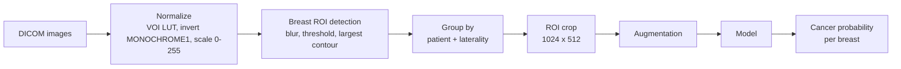
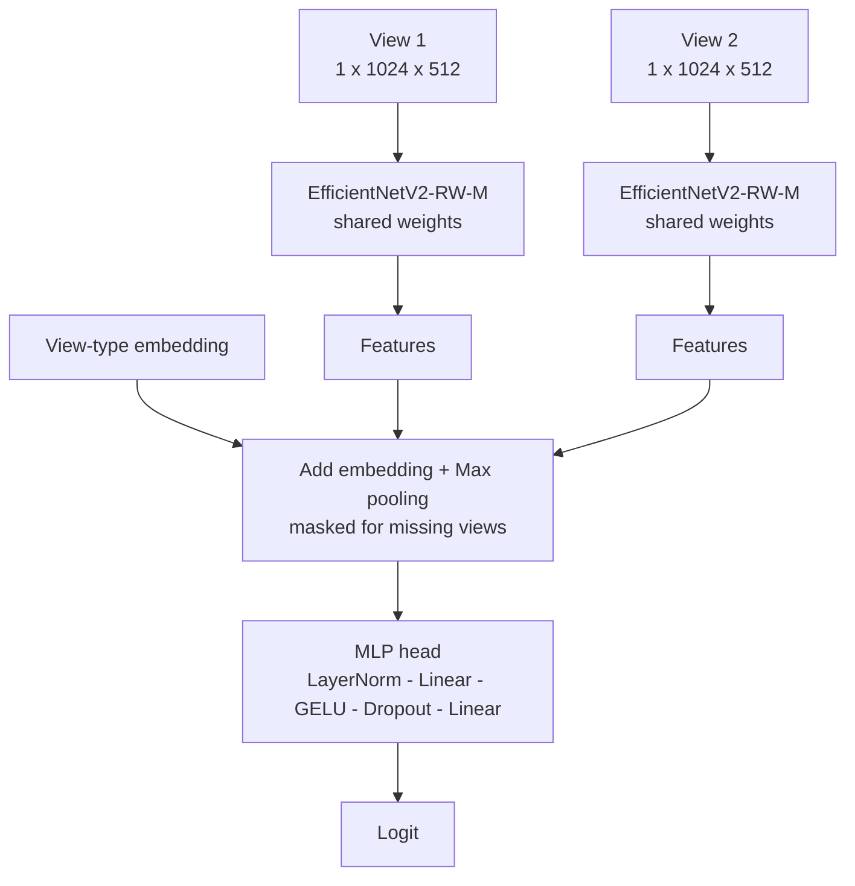
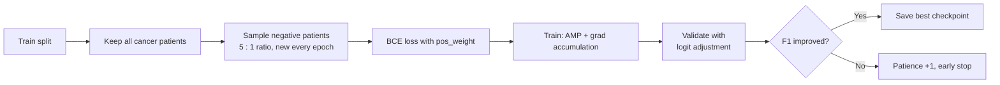

# Mammo: Multi-View Breast Cancer Detection

Deep learning pipeline for breast cancer detection from screening mammograms, built for the [RSNA Screening Mammography Breast Cancer Detection](https://www.kaggle.com/competitions/rsna-breast-cancer-detection) challenge.

The model looks at **all available views of one breast** (e.g. CC and MLO) and predicts one cancer score per patient and side.

---

## Highlights

- **Breast ROI cropping**: removes background and markers, so the model sees more tissue detail.
- **Multi-view input**: up to 2 views per breast, combined with a view-type embedding and max pooling.
- **Imbalance handling**: patient-level negative downsampling each epoch, `pos_weight` loss, and logit adjustment back to real prevalence.
- **Memory-friendly training**: mixed precision (fp16), gradient accumulation, and gradient checkpointing.
- **Metrics**: probabilistic F1 / F2 and best-threshold search.

---

## Pipeline



## Model



## Training Strategy



---

## Project Structure

```
.
├── configs.py                  # All settings (image size, batch size, LR, AMP...)
├── src/
│   ├── main.py                 # Entry point: split data, run training
│   ├── dataset/
│   │   ├── SaveROI.py          # Compute and save breast bounding boxes
│   │   ├── preprocessing.py    # Normalization, ROI detection, random crop
│   │   ├── augmentation.py     # Albumentations train / valid transforms
│   │   ├── MammoDatasetVariousAugPerView.py
│   │   └── BalancedPatientSampler.py
│   ├── models/
│   │   ├── ImageEncoder.py     # timm backbone (per view)
│   │   ├── ViewSetPooling.py   # max / mean / GeM pooling + head
│   │   ├── ViewSetAgg.py       # Transformer + attention MIL (alternative)
│   │   └── ModelHybrid.py      # Encoder + aggregator
│   ├── train/Trainer.py        # Training, validation, checkpointing
│   └── utils/utils.py          # Metrics, logit adjustment, helpers
└── assets/data/                # train.csv, train_with_bbox.csv
```

---

## Getting Started

**1. Install**

```bash
pip install torch timm albumentations opencv-python pydicom dicomsdl \
            pylibjpeg pylibjpeg-libjpeg pandas scikit-learn matplotlib tqdm
```

**2. Prepare ROI boxes** (run once)

```bash
python src/dataset/SaveROI.py
```

**3. Train**

```bash
python src/main.py
```

> Data and weight paths currently point to Kaggle (`/kaggle/input/...`). Change them in `Trainer.py`, `ImageEncoder.py`, and the dataset files to run locally.

## Key Settings (`configs.py`)

| Setting | Value |
|---|---|
| Image size | 512 (crop 1024 x 512) |
| Views per breast | 2 |
| Negative : positive ratio | 5 : 1 |
| Batch size / accumulation | 16 / 4 |
| Optimizer | AdamW (backbone 1e-5, head 1e-4) |
| Scheduler | 4 warm-up epochs + cosine |
| Early stopping patience | 8 |
| Precision | Mixed (fp16) |

---

## Results

<!-- Add validation metrics, comparison tables, and plots here -->

---

## Explainability (XAI)

<!-- Add Grad-CAM / saliency examples here -->

---

## Limitations & Future Work

<!-- Add notes here -->

---

## Acknowledgements

- Data: [RSNA Screening Mammography Breast Cancer Detection](https://www.kaggle.com/competitions/rsna-breast-cancer-detection)
- Backbone: [timm](https://github.com/huggingface/pytorch-image-models)

## License

Add your license here (e.g. MIT).
